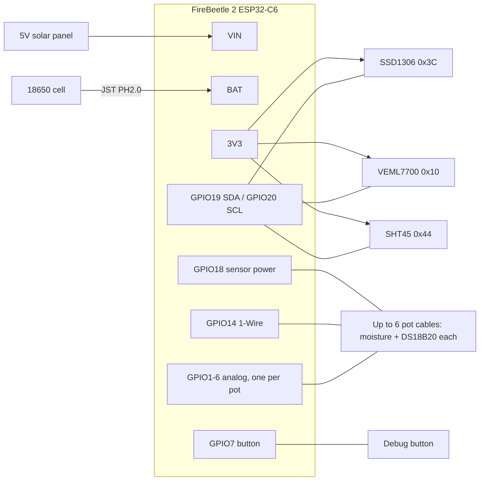

# Wiring (FireBeetle 2 ESP32-C6 build)

This is the planned battery and solar build. Parts are listed in [issue #1](https://github.com/treefitty/greenhouse-monitor/issues/1).
The current Witty bench setup is in [hardware.md](hardware.md).

Pin numbers are GPIO numbers. The silkscreen label is in brackets. They come from the Arduino pin
map for this board ([`pins_arduino.h`](https://github.com/espressif/arduino-esp32/blob/master/variants/dfrobot_firebeetle2_esp32c6/pins_arduino.h)).

## Overview

Everything shares one ground.

## Pins

| GPIO (label) | Connects to | Notes |
|---|---|---|
| 19 (SDA) | SDA on OLED, VEML7700, SHT45 | I2C bus |
| 20 (SCL) | SCL on OLED, VEML7700, SHT45 | I2C bus |
| 18 (D7) | Power wire of every pot cable | Sensor power. Firmware sets it high to read and low before sleep |
| 14 (D3) | Temperature data wire of every pot cable | 1-Wire bus. Each probe has its own address, so one pin serves all pots |
| 2 (A1) | Pot 1 moisture | |
| 3 (A2) | Pot 2 moisture | |
| 4 (A3) | Pot 3 moisture | |
| 5 (A4) | Pot 4 moisture | Future |
| 1 (D6) | Pot 5 moisture | Future |
| 6 (D12) | Pot 6 moisture | Future |
| 7 (D11) | Push button, other side to GND | Debug screen. Wakes the board from deep sleep |
| 0 | — | **Leave free.** The board reads battery voltage on it |
| 9 (BOOT), 15 (D13, LED) | — | Onboard boot button and LED. Leave free |

GPIO1–6 are the only free pins that can read analog. Pots beyond 6 need an ADS1115 board in the
box (4 more analog inputs over I2C each, up to 4 boards). The pot cables stay the same.

GPIO4 and 5 are also read once at power-on to pick a debug mode. That's harmless here, because
the sensors are unpowered at boot.

## I2C devices (always powered)

| Device | VCC | GND | SDA | SCL | Address |
|---|---|---|---|---|---|
| SSD1306 OLED | 3V3 | GND | 19 | 20 | 0x3C |
| VEML7700 | 3V3 | GND | 19 | 20 | 0x10 |
| SHT45 probe | 3V3 | GND | 19 | 20 | 0x44 |

All three stay on 3V3 because they draw microamps when idle. Firmware switches the OLED off
before sleep (command 0xAE). Every module has its own pull-up resistors. Three sets in parallel is
fine.

Wire colours on the SHT45 probe vary by seller. Check the listing or the label before connecting.

## Pot cables

Each pot has one moisture sensor and one DS18B20 temperature probe, joined at a sealed sensor head
and run back to the box on one 4-core screened cable (Jaycar
[WB1510](https://www.jaycar.com.au/4-core-round-screened-audio-cable-sold-per-metre/p/WB1510)).
Each pot has its own cable, all the way to the box. Don't split one trunk cable: each moisture
sensor needs its own signal wire, and a junction box among the pots would be the weakest point.

| Core | Moisture sensor | DS18B20 | Box end |
|---|---|---|---|
| 1 | VCC | Red | Power terminal → GPIO18 |
| 2 | GND | Black | GND terminal |
| 3 | AOUT | — | That pot's analog pin (table above) |
| 4 | — | Yellow (DQ) | 1-Wire terminal → GPIO14 |
| Screen | — | — | GND terminal. **Box end only**: cut it back and tape it at the pot |

The cable's core colours aren't the same as above. Pick a colour for each role, write it down here,
and use it for every pot.

### At the pot: the sensor head

1. Cut the plug off the moisture sensor and solder the 4-core cable straight to its pads.
2. Cut the DS18B20 cable to leave **15–20 cm** on the probe. That way the steel tip can sit at root
   depth (about 10 cm), away from the moisture sensor. Solder its 3 wires to the matching cores.
3. Check the moisture sensor's chip says **TLC555**, not NE555. NE555 boards misbehave at 3.3 V.
4. Seal everything above the line on the moisture sensor, including the joints: conformal coating
   or nail polish, then adhesive-lined heatshrink or epoxy over the whole head. Unsealed sensors
   corrode within a season.
5. Push the moisture sensor in only up to the line on the board.

### At the box

- Each cable comes in through a gland (or one hole of a multi-hole gland), with a drip loop just
  before it so water drips off rather than running along the cable into the box.
- Inside, cores land on screw terminals: one shared power terminal, one shared GND terminal, one
  shared 1-Wire terminal, and one terminal per pot for moisture.
- Put **one** 4.7 kΩ resistor between the 1-Wire terminal and the power terminal. The adapter
  board from the DS18B20 kit has one. Don't add a resistor per pot.
- Put a 100 nF capacitor from each moisture pin to GND to steady the readings.
- The PVC cable isn't UV-rated. Run it under the benches or in conduit, out of direct sun.

### Sensor power

Each moisture sensor draws about 5 mA and each DS18B20 about 1.5 mA while measuring. That's about
20 mA for 3 pots, which GPIO18 can supply directly. **From 4 pots up**, switch sensor power through
a P-channel MOSFET or a load-switch module rather than straight off the pin.

### Readings

- Moisture: the firmware switches power on, waits about 100 ms, and averages about 16 readings per
  pot. Calibrate each sensor: read it in dry air, then in a glass of water. Readings drop as soil
  gets wetter.
- Temperature: the firmware tells the probes apart by their 64-bit address. To match addresses to
  pots, print them all, warm one probe in your hand and see which reading climbs. Label that
  pot's cable and put its address in the firmware config.
- 1-Wire cable length: what counts is the total of all pot cables. Up to about 10 m in total is
  reliable with the 4.7 kΩ resistor (three 3 m cables is 9 m). Beyond that, or if readings drop
  out (−127 °C or 85 °C), use 2.2 kΩ instead.

## Debug button

The screen is for debugging only. Both it and the button sit inside the case and are used with the
lid open. Readings are checked over Wi-Fi.

A momentary push button between GPIO7 (D11) and GND. GPIO7 is one of the ESP32-C6's low-power
pins, which can wake the chip from deep sleep. The firmware enables its internal pull-up. Pressing
the button wakes the board and shows the screen for 30 s.

## Power

| From | To |
|---|---|
| 18650 holder (+ red, − black) | JST PH2.0 lead → BAT socket |
| Solar panel + | VIN |
| Solar panel − | GND |

- **Check polarity with a meter before plugging in the battery.** JST leads from different sellers
  have the red and black wires swapped. Red must go to the + marking beside the BAT socket.
- Use a **5 V** panel. The board's solar input is rated 5 V, and some sources say up to 6 V.
  The "6V" panels go above 7 V with no load.
- The charger (CN3165) charges at up to 0.5 A. The **Charge** LED is on while charging.
- Unplug the panel while the board is on USB, until we've confirmed the board handles both at once.
- Keep the battery out of direct sun. Li-ion shouldn't charge above 45 °C.

## Enclosure

- Board, battery, OLED and button all go in the IP65 box. There's no window, so the lid stays sealed
  except when debugging.
- Cables in through glands: one per pot, plus the SHT45 probe and the panel. A multi-hole gland
  saves drilling a hole per pot.
- The VEML7700 needs to see the sky. Mount it behind a clear window, facing up, or in its own
  small sealed box. A window cuts some of the light, so readings are relative unless you calibrate.
- Hang the SHT45 probe in shade, ideally in a radiation shield. A sensor in direct sun reads several
  degrees high.
