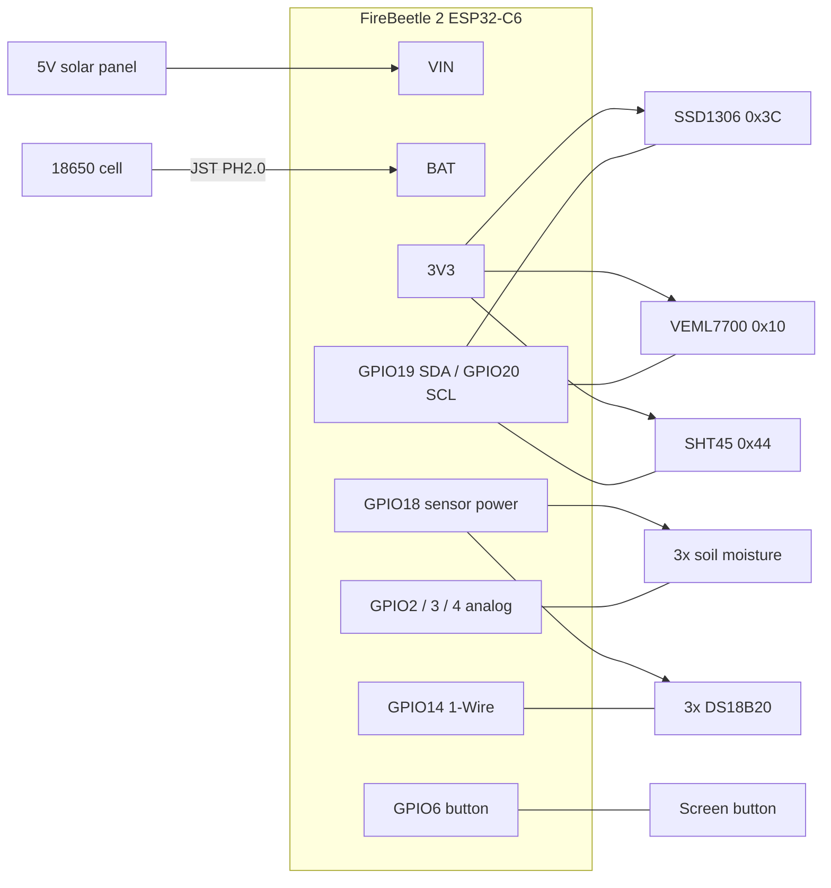

# Wiring (FireBeetle 2 ESP32-C6 build)

This is the planned battery and solar build. Parts are listed in [issue #1](https://github.com/treefitty/greenhouse-monitor/issues/1).
The current Witty bench setup is in [hardware.md](hardware.md).

Pin numbers are GPIO numbers. The silkscreen label is in brackets. They come from the Arduino pin
map for this board ([`pins_arduino.h`](https://github.com/espressif/arduino-esp32/blob/master/variants/dfrobot_firebeetle2_esp32c6/pins_arduino.h)).

## Overview

Everything shares one ground.

## Pins

| GPIO (label) | Connects to | Notes |
|---|---|---|
| 19 (SDA) | SDA on OLED, VEML7700, SHT45 | I2C bus |
| 20 (SCL) | SCL on OLED, VEML7700, SHT45 | I2C bus |
| 18 (D7) | VCC of all 3 moisture sensors and all 3 DS18B20s | Sensor power. Firmware sets it high to read and low before sleep |
| 2 (A1) | Moisture sensor 1 AOUT | Pot 1 |
| 3 (A2) | Moisture sensor 2 AOUT | Pot 2 |
| 4 (A3) | Moisture sensor 3 AOUT | Pot 3 |
| 14 (D3) | DQ (data) of all 3 DS18B20s | 1-Wire bus. Each probe has its own address, so one pin serves all three |
| 6 (D12) | Push button, other side to GND | Turns the screen on. Wakes the board from deep sleep |
| 0 | — | **Leave free.** The board reads battery voltage on it |
| 9 (BOOT), 15 (D13, LED) | — | Onboard boot button and LED. Leave free |

## I2C devices (always powered)

| Device | VCC | GND | SDA | SCL | Address |
|---|---|---|---|---|---|
| SSD1306 OLED | 3V3 | GND | 19 | 20 | 0x3C |
| VEML7700 | 3V3 | GND | 19 | 20 | 0x10 |
| SHT45 probe | 3V3 | GND | 19 | 20 | 0x44 |

All three stay on 3V3 because they draw microamps when idle. Firmware switches the OLED off
before sleep (command 0xAE). Every module has its own pull-up resistors. Three sets in parallel is
fine.

Wire colours on the SHT45 probe vary by seller. Check the listing or the label before connecting.

## Soil moisture (×3)

| Sensor pin | Connects to |
|---|---|
| VCC | GPIO18 (sensor power) |
| GND | GND |
| AOUT | GPIO2 / 3 / 4, one per sensor |

- They draw about 5 mA each, so they're only powered while being read. Wait about 100 ms after
  switching power on before reading.
- Check the chip says **TLC555**, not NE555, before use. NE555 boards misbehave at 3.3 V.
- Push them in only up to the line on the board. The parts above it aren't waterproof. Seal the cut
  edges and the parts with nail polish or conformal coating, or they corrode within a season.
- Calibrate each one: read it in dry air, then in a glass of water. Readings drop as soil gets wetter.
- The supplied cables are short. Extend them with 3-core cable to reach the pots. A few metres is
  fine for this analog signal.

## Soil temperature: DS18B20 (×3)

| Probe wire | Connects to |
|---|---|
| Red (VCC) | GPIO18 (sensor power) |
| Black (GND) | GND |
| Yellow (DQ, data) | GPIO14 |

- All three probes connect in parallel on the same three wires.
- The bus needs **one** 4.7 kΩ resistor between DQ and VCC. The adapter board from the kit has it.
  Connect all three probes to the adapter's terminals. Don't add a resistor per probe.
- Firmware tells the probes apart by their 64-bit address. Label each probe with its pot when you
  first read the addresses.
- Bury the steel tip at root depth, about 10 cm.
- Cable length: what counts is the total of all three cables. Up to about 10 m in total is
  reliable at 3.3 V. Three 3 m probes is 9 m. If readings drop out (−127 °C or 85 °C), try a
  2.2 kΩ pull-up in place of the 4.7 kΩ one.

## Screen button

The screen is for debugging only. Both it and the button sit inside the case and are used with the
lid open. Readings are checked over Wi-Fi.

A momentary push button between GPIO6 (D12) and GND. GPIO6 is one of the ESP32-C6's low-power
pins, which can wake the chip from deep sleep. The firmware enables its internal pull-up. Pressing
the button wakes the board and shows the screen for 30 s.

## Power

| From | To |
|---|---|
| 18650 holder (+ red, − black) | JST PH2.0 lead → BAT socket |
| Solar panel + | VIN |
| Solar panel − | GND |

- **Check polarity with a meter before plugging in the battery.** JST leads from different sellers
  have the red and black wires swapped. Red must go to the + marking beside the BAT socket.
- Use a **5 V** panel. The board's solar input is rated 5 V, and some sources say up to 6 V.
  The "6V" panels go above 7 V with no load.
- The charger (CN3165) charges at up to 0.5 A. The **Charge** LED is on while charging.
- Unplug the panel while the board is on USB, until we've confirmed the board handles both at once.
- Keep the battery out of direct sun. Li-ion shouldn't charge above 45 °C.

## Enclosure

- Board, battery, OLED and button all go in the IP65 box. There's no window, so the lid stays sealed
  except when debugging.
- Run every cable through a PG7 gland: SHT45 probe, 3 moisture cables, the DS18B20 bus and the panel.
- The VEML7700 needs to see the sky. Mount it behind a clear window, facing up, or in its own
  small sealed box. A window cuts some of the light, so readings are relative unless you calibrate.
- Hang the SHT45 probe in shade, ideally in a radiation shield. A sensor in direct sun reads several
  degrees high.
